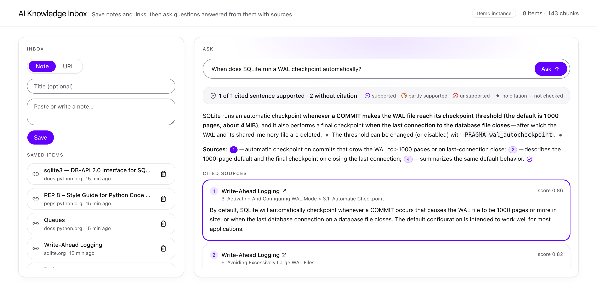
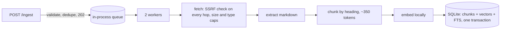
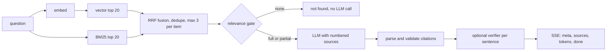

# AI Knowledge Inbox

Save notes and URLs, then ask questions answered only from them, with numbered citations and source snippets.

**Live demo:** https://ai-knowledge-inbox-production-4f640fd4.up.railway.app (shared, rate-limited, nothing to install)



## Contents

1. [Quick start](#quick-start)
2. [Architecture](#architecture)
3. [API](#api)
4. [Design decisions and tradeoffs](#design-decisions-and-tradeoffs)
5. [Evaluation](#evaluation)
6. [Known limitations](#known-limitations)
7. [Scope](#scope)
8. [Repo map](#repo-map)

## Quick start

**a) Live link.** Open the demo above. It has sample notes and four documentation pages. Limits: 10 saves and 30 questions per hour per address, 100 items in total.

**b) Docker** (one container: API, frontend and demo data):

```bash
cp .env.example .env          # then set GROQ_API_KEY (free key: https://console.groq.com/keys)
docker compose up --build     # the first build takes 1-2 minutes
open http://localhost:8000    # demo items are loaded on first start
```

**c) Without Docker** (Python 3.12 with `uv`, Node 22+):

```bash
make install                  # backend deps, tokenizer and embedding model, frontend deps
cp .env.example .env          # set GROQ_API_KEY
make dev                      # API on :8000, frontend on http://localhost:5173
make seed                     # optional: add the demo items
```

**d) Tests.** After `make install`, `make test` runs offline with no API keys (fake embedder and LLM, a temporary database per test). `make lint` runs ruff, oxlint and the TypeScript compiler.

## Architecture

FastAPI backend, React frontend, one SQLite file (sqlite-vec for vectors, FTS5 for keyword search). Embeddings run locally (bge-small via fastembed). Answers come from an OpenAI-compatible API (Groq by default). Services are synchronous; the async boundary is the API layer and the ingestion worker.

**Ingestion**



**Querying**



## API

All errors use one envelope: `{"error": {"code", "message", "details"}, "request_id"}`. Every response carries `X-Request-ID`. OpenAPI docs are at `/docs`.

| Method | Path | What it does | Statuses |
|---|---|---|---|
| POST | `/ingest` | Save a note `{type: "note", content, title?}` or a URL `{type: "url", url}`; processed in the background | 202, 409 duplicate, 422 |
| GET | `/items` | List items, newest first, cursor pagination, filter by `status` and `type` | 200 |
| GET | `/items/{id}` | One item with its extracted text | 200, 404 |
| DELETE | `/items/{id}` | Delete an item with its chunks and vectors | 204, 404 |
| GET | `/items/stats` | Item and chunk counts | 200 |
| POST | `/query` | Answer with citations (JSON) | 200, 422, 503 |
| POST | `/query/stream` | The same answer as server-sent events | 200 |
| GET | `/health` | Database, sqlite-vec and provider status | 200, 503 |

A real response from the demo, trimmed (`…`):

```bash
curl -s -X POST localhost:8000/query -H 'content-type: application/json' \
  -d '{"question": "How often should I feed a sourdough starter?", "top_k": 3}'
```

```json
{
  "answer": "You should feed an active sourdough starter **twice each day** (e.g., 50 g flour + 50 g water each feeding) and discard down to 50 g before each feeding. …",
  "mode": "full",
  "citations": [
    {"ref": 1, "item_id": "42922f71…", "chunk_id": 2, "title": "Sourdough starter care",
     "source_url": null, "item_type": "note", "section": null,
     "snippet": "Sourdough starter care Feed the starter twice a day with equal weights of flour …",
     "score": 0.888}
  ],
  "timings_ms": {"embed": 15.9, "retrieve": 18.3, "rerank": 0.0, "generate": 642.2, "total": 940.6},
  "request_id": "a98e307a…",
  "verification": {"backend": "jev", "summary": {"supported": 1, "partial": 0, "unsupported": 1, "total": 2}, "sentences": ["…"]}
}
```

`mode` is `full`, `partial` or `none`; with `none` the LLM is not called. `verification` is `null` unless a verifier is configured. Here the first sentence carried no citation, so it counts as `unsupported` (not checked).

## Design decisions and tradeoffs

**Chunking.** Markdown is split on `#`, `##` and `###`, and each chunk keeps its heading path as its section. Long sections are split by paragraph, then sentence, into chunks of about 350 tokens, with 60 tokens of overlap inside a section only. 350 keeps a chunk plus its header under bge-small's 512-token limit. Tables and code blocks stay whole up to 400 tokens. Fragments under 50 tokens merge into a neighbour, and repeated paragraphs and chunks are dropped. A short note is one chunk. Each chunk is embedded with a `Title / Section` header (cheap contextual retrieval); the header is never shown in snippets.

**Vector store.** One SQLite file holds items, chunks, vectors (sqlite-vec, cosine, brute-force KNN) and a BM25 index (FTS5). Vector and keyword results are fused with reciprocal rank fusion (k = 60). There is no extra service to run, and chunks, vectors and the FTS index are written in one transaction, with triggers so a delete cascades to all three. Keyword search catches exact terms such as `PRAGMA wal_autocheckpoint` that embeddings blur. Embeddings are local and free (bge-small, 384 dimensions); OpenAI embeddings are a config switch.

**What breaks at scale.** sqlite-vec scans every vector on each query, so latency grows linearly with the corpus: fine for thousands of chunks, not millions. SQLite allows one writer at a time, and the ingestion queue, the demo rate limits and the embedding model live in one process, so the app runs as a single replica. CPU embedding is the slow step: about 8 s for a 27-chunk page on the demo host. There are no users or tenants; everyone shares one inbox.

**Production changes.** Postgres with pgvector (HNSW index) or a managed vector store. A durable job queue with separate workers instead of the in-process queue. Authentication and per-user data. URL fetching through an egress proxy that pins the resolved IP. Rate limits in a shared store. A reranker on the fused candidates. Tracing and metrics on top of the existing structured logs and request IDs.

## Evaluation

85 questions over 13 notes and 4 documentation pages, in 6 kinds (answerable, near-miss, out-of-scope, multi-source, conflicting, prompt injection), split 43 dev / 42 test. The method, the labels and every table are in [backend/eval/README.md](backend/eval/README.md).

| What | Result |
|---|---|
| Retrieval, hybrid vs one arm (MRR) | 0.90 hybrid vs 0.86 BM25 and 0.82 vector only; hit@5 0.98. Not a significant difference. |
| Relevance gate at 0.59 (test split) | 0 errors, but the dev margin is 0.009 on each side, and near-miss questions score inside the answerable range. |
| Verifier accuracy (143 cited sentences) | Jev 92%, Jev + escalation 93%, LLM verifier 90%. The confidence intervals overlap. |
| The one real wrong-citation sentence | Missed by every verifier (1 of 50 unsupported let through); all 48 synthetic errors were caught. |
| Prompt injection (dev answers) | 4 of 39 repeated a planted instruction with the "cite both sides" rule, 2 before it. The biggest weakness. |

## Known limitations

- **Injection that imitates a closing tag.** Sources are wrapped in `<source>…</source>` and the prompt says to treat them as data, but source text is not escaped. A saved page containing `</source>` followed by instructions can look as if it sits outside the sources. The eval shows injection already gets through without this trick.
- **JS-only pages.** The fetcher does not run JavaScript, so single-page apps give little or no text. An optional headless-browser fallback exists (`make install-render`, then `JS_RENDER=on`). It is off by default and disabled in demo mode.
- **Small, self-built eval set.** 85 questions on 17 items, written for this project. Labels come from two models and were adjudicated by me. One run per verifier, so run-to-run variance is not measured.
- **Single user.** There are no accounts. On the shared demo anyone can add or delete items.

## Scope

The core brief is the required features: saving notes and URLs, `/ingest`, `/items`, `/query`, answers with cited sources and snippets, and the frontend. Three extras are optional and off by default when run locally:

- **Answer verification** (`VERIFIER=jev`, needs an OpenRouter key). It is on for the live demo.
- **The evaluation harness** (`make eval`). Most steps are free; the verifier runs cost a few cents.
- **JavaScript rendering** (`JS_RENDER=on`).

## Repo map

```
backend/    FastAPI app (app/), tests (tests/), eval data and results (eval/), eval and seed scripts (scripts/)
frontend/   React + TypeScript UI (Vite, Tailwind, shadcn/ui, TanStack Query)
docs/       Screenshots
Dockerfile, docker-compose.yml, docker-entrypoint.sh, railway.json   single-container build and deploy
Makefile    install, dev, test, lint, seed, eval, docker
```
